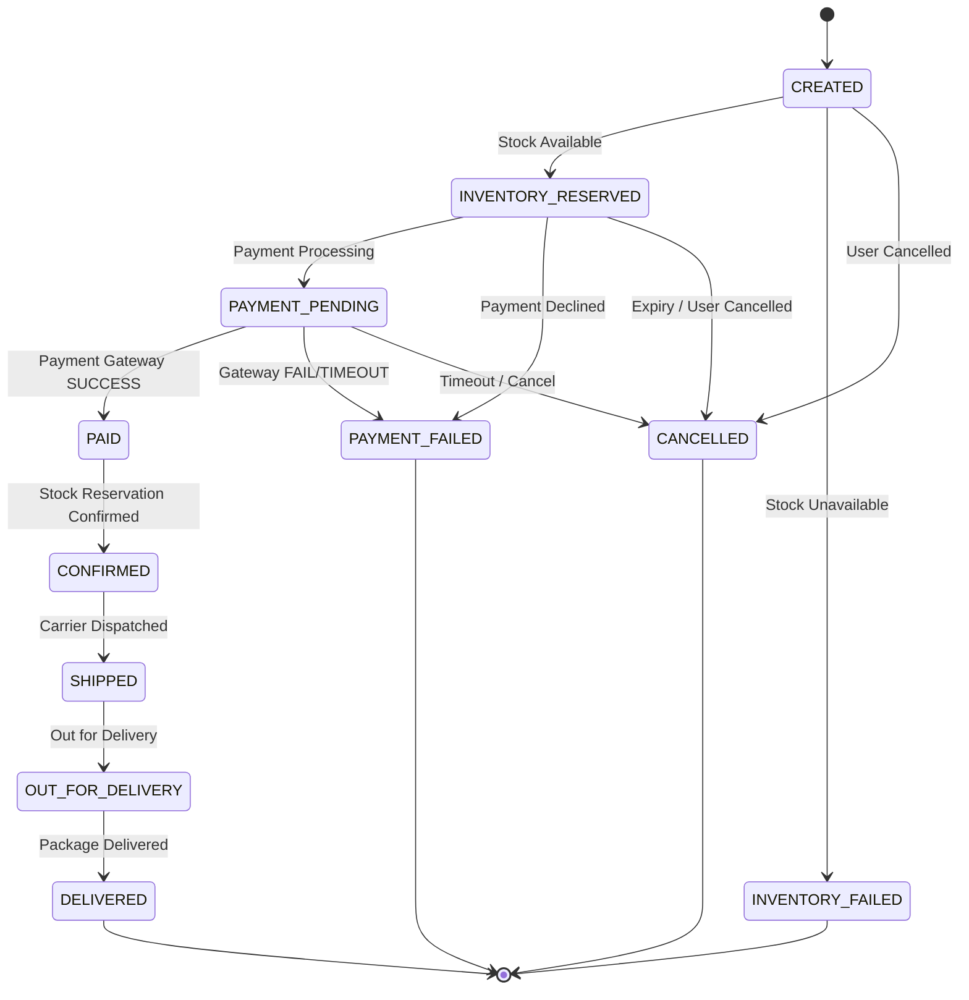
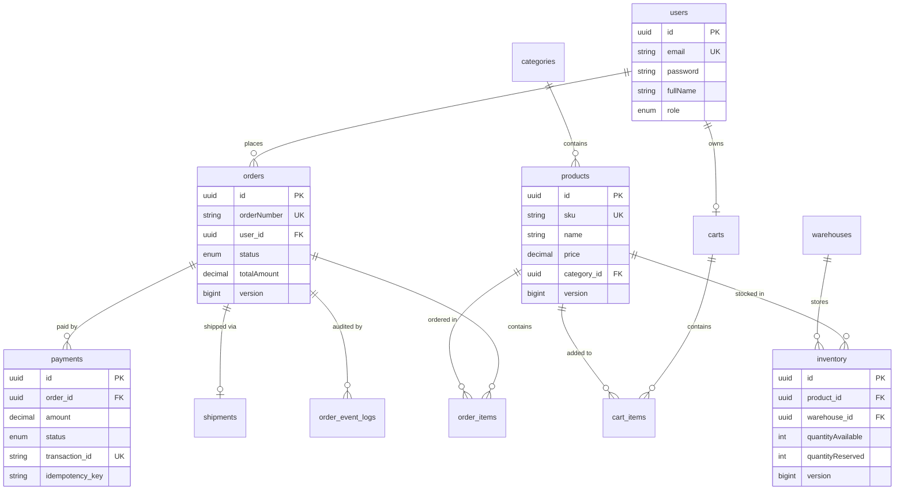

# Enterprise Order Management System (OMS)

[](https://www.oracle.com/java/)
[](https://spring.io/projects/spring-boot)
[](https://www.postgresql.org/)
[](https://redis.io/)
[](https://kafka.apache.org/)
[](LICENSE)

A production-grade, distributed **Enterprise Order Management System (OMS)** designed with Spring Boot 3, Event-Driven Architecture (EDA) via Apache Kafka, Redis distributed locking for high-concurrency inventory reservation, strict State Machine order lifecycle, Idempotent payment processing, and React + TypeScript analytics dashboard.

---

## Architecture Diagram

```mermaid
flowchart TD
    subgraph Client Layer
        UI["React + TypeScript Dashboard"]
    </div>

    subgraph API Layer & Security
        GW["Spring Security + JWT API Gateway"]
        MDC["Correlation ID MDC Filter"]
    end

    subgraph Core Domain Services
        US["User Service (RBAC & Auth)"]
        PS["Product Service (Redis Cache)"]
        IS["Inventory Service (Redis Lock & Optimistic Lock)"]
        OS["Order Service (Order State Machine)"]
        PY["Payment Service (Idempotency Engine & Simulated Gateway)"]
        SS["Shipping Service"]
        NS["Notification Service"]
    end

    subgraph Event Streaming & Storage
        KAFKA["Apache Kafka Event Bus"]
        PG[(PostgreSQL Database)]
        REDIS[(Redis Cache & Lock Store)]
    end

    UI --> GW
    GW --> MDC
    MDC --> US
    MDC --> PS
    MDC --> IS
    MDC --> OS
    MDC --> PY
    MDC --> SS

    PS <--> REDIS
    IS <--> REDIS
    PY <--> REDIS

    US --> PG
    PS --> PG
    IS --> PG
    OS --> PG
    PY --> PG
    SS --> PG
    NS --> PG

    OS -- "OrderCreated / OrderCancelled" --> KAFKA
    IS -- "InventoryReserved / Failed" --> KAFKA
    PY -- "PaymentSucceeded / PaymentFailed" --> KAFKA
    SS -- "ShipmentCreated / Delivered" --> KAFKA

    KAFKA --> OS
    KAFKA --> IS
    KAFKA --> PY
    KAFKA --> NS
```

---

## 1. Core Technology Stack

| Component | Technology | Rationale |
| :--- | :--- | :--- |
| **Backend Framework** | Java 17, Spring Boot 3.2.4, Spring Web | Production standard with high throughput, modern Java records/pattern matching, and robust ecosystem. |
| **Database** | PostgreSQL 16 + Hibernate ORM | ACID compliance, strict foreign key constraints, indexes, and JSONB audit capability. |
| **Caching & Locking** | Redis 7 + Spring Data Redis | Sub-millisecond product lookup cache and atomic distributed locking (`setIfAbsent`) for inventory race conditions. |
| **Messaging** | Apache Kafka | Asynchronous event-driven communication enabling decoupling of Order, Inventory, Payment, and Shipping services. |
| **Security** | Spring Security + JWT (jjwt 0.12.5) | Stateless authentication with Role-Based Access Control (RBAC) across 4 system roles. |
| **Testing** | JUnit 5, Mockito, Spring Boot Test | Complete coverage of unit logic, concurrency, state machine transitions, and end-to-end integration flows. |
| **Observability** | Micrometer, Prometheus, Actuator | Structured MDC request correlation tracing (`X-Correlation-ID`) and custom counters (`oms_orders_created_total`). |
| **Frontend** | React 18, TypeScript, Vite, Tailwind CSS | Professional management dashboard for live order tracking, state machine visualizer, and inventory stock adjustment. |

---

## 2. Order State Machine

The order lifecycle is strictly governed by a dedicated `OrderStateMachine` component to prevent invalid state transitions.



---

## 3. Database Schema (Entity-Relationship Diagram)



---

## 4. Concurrency & High-Throughput Inventory Reservation

### The Problem
When Customer A and Customer B attempt to check out the **last available unit** (`stock = 1`) at the exact same millisecond, naive database updates cause race conditions resulting in overselling.

### The Solution
1. **Redis Distributed Lock**: Prior to reading stock levels, `InventoryService` acquires a Redis distributed lock (`lock:inventory:product:{id}`) using atomic `setIfAbsent` with TTL.
2. **Optimistic Locking (`@Version`)**: JPA entities utilize `@Version` column versioning. If two concurrent transactions bypass lock TTL, Hibernate throws `OptimisticLockException` preventing corrupted stock writes.
3. **Reservation TTL & Auto-Release**: Stock is placed into `quantityReserved`. If payment fails or is not completed within 15 minutes, a scheduled task (`releaseExpiredReservations`) releases reserved stock back into `quantityAvailable`.

---

## 5. Idempotency Engine Design

To protect financial transactions and order creation from network retries or duplicate POST submissions:
- Requests accept an optional `Idempotency-Key` header (e.g. `Idempotency-Key: e4a2b910-84a1...`).
- Before processing `POST /orders`, `POST /payments`, or `POST /payments/{id}/retry`, `IdempotencyService` checks Redis and the `idempotency_records` PostgreSQL table.
- If the key exists, the cached `ApiResponse` payload is immediately returned with `200 OK` without re-executing business logic or charging the customer twice.

---

## 6. Security & Role-Based Access Control (RBAC)

Spring Security enforces stateless JWT bearer token authentication and method-level security:

- **CUSTOMER**: View product catalog, manage own shopping cart, create orders, view own order history.
- **ADMIN**: Product & category management (`POST/PUT/DELETE /products`), full visibility into all enterprise orders and inventory levels.
- **WAREHOUSE_MANAGER**: Access inventory management, update available stock, create and update shipment dispatch statuses.
- **SUPPORT_AGENT**: Read-only access to customer orders and shipment tracking for customer support resolution.

---

## 7. Running Locally with Docker Compose

### Prerequisites
- Docker Desktop installed
- Java 17+ (optional for local running outside Docker)

### Launch Complete Application Stack
```bash
git clone https://github.com/enterprise/enterprise-oms.git
cd enterprise-oms

# Build and start PostgreSQL, Redis, Kafka, Zookeeper, Backend API, and Frontend Dashboard
docker compose up --build
```

Access Services:
- **React Dashboard**: [http://localhost:3000](http://localhost:3000)
- **Spring Boot Backend**: [http://localhost:8080](http://localhost:8080)
- **OpenAPI / Swagger UI**: [http://localhost:8080/swagger-ui.html](http://localhost:8080/swagger-ui.html)
- **Prometheus Metrics**: [http://localhost:8080/actuator/prometheus](http://localhost:8080/actuator/prometheus)

### Default Accounts for Evaluation
- **Admin**: `admin@enterprise.com` / `admin123`
- **Customer**: `customer@enterprise.com` / `customer123`
- **Warehouse Manager**: `warehouse@enterprise.com` / `manager123`
- **Support Agent**: `support@enterprise.com` / `support123`

---

## 8. Interview-Oriented Engineering Decisions

Here are standard technical interview questions and how this codebase implements the answers:

### 1. Why PostgreSQL instead of MongoDB?
PostgreSQL provides strict ACID guarantees, normalized relational schemas, non-repeatable read prevention, and explicit foreign keys. Financial systems and order management require zero tolerance for uncommitted read data corruption.

### 2. Why Redis?
Redis serves two critical roles: (1) Caching hot product catalog queries (`@Cacheable`) with fast TTL invalidation, and (2) High-throughput atomic distributed locking for inventory reservation.

### 3. Why Kafka?
Kafka decouples synchronous HTTP requests from background workflows (inventory verification, payment events, shipping dispatch, email notifications). This prevents slow external gateways (e.g. payment/email) from bottlenecking order placement throughput.

### 4. How is inventory concurrency handled?
Through a 2-tier defense mechanism: Redis distributed locking per product ID for atomic reservation checks, combined with database optimistic locking (`@Version`) on PostgreSQL `inventory` entities.

### 5. How is idempotency implemented?
Via an `Idempotency-Key` HTTP header. The system computes a hash of the key, checks Redis/PostgreSQL for existing execution records, and returns the cached HTTP envelope if a retry is detected.

### 6. What happens if payment succeeds but Order Service crashes?
The Payment Service publishes `PaymentSucceededEvent` to a persistent, replicated Kafka topic. When Order Service recovers, its Kafka consumer group reads the uncommitted offset and completes the order transition to `CONFIRMED`.

### 7. What happens if Kafka is temporarily unavailable?
The system utilizes local database transaction boundaries and graceful fallback handlers (`KafkaEventPublisher`), recording audit event logs into `order_event_logs` to re-sync state once Kafka reconnects.

### 8. How would the system scale to 1 million orders/day?
By horizontally scaling Order Service instances behind an API Gateway, partitioning Kafka topics by `orderId`, utilizing Redis cluster mode for distributed locks, and implementing database read-replicas for product search queries.

---

## 9. Testing & Quality Assurance

Run the automated JUnit 5 & Mockito test suite:
```bash
./mvnw clean test
```

Test coverage includes:
- Order State Machine transitions and invalid transition rejection
- Unit tests for Order, Payment, and Inventory services
- Concurrent multithreaded inventory reservation tests
- End-to-end integration tests (`OrderLifecycleIntegrationTest`)
